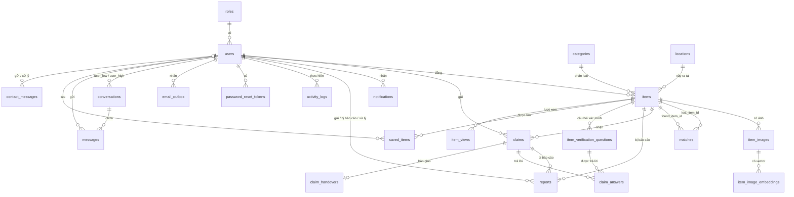

# FindIt — Thiết kế cơ sở dữ liệu (ERD)

Tài liệu mô tả thiết kế logic của database MySQL 8. Định nghĩa vật lý nằm trong `database/schema.js`, `database/features-schema.js`, `database/phase5-schema.js` và thư mục `database/migrations/`; cách cài đặt và vận hành xem [README database](../database/README.md).

## 1. Quy ước

### 1.1. Ký hiệu ràng buộc

| Ký hiệu | Ý nghĩa |
| --- | --- |
| PK | Khóa chính |
| FK | Khóa ngoại |
| UQ | Giá trị duy nhất |
| NN | Bắt buộc có giá trị (NOT NULL) |
| NULL | Được phép để trống |
| DEFAULT | Giá trị mặc định |

### 1.2. Quy ước dữ liệu

- Khóa chính kiểu `BIGINT UNSIGNED AUTO_INCREMENT`; khóa ngoại cùng kiểu với cột được tham chiếu.
- Thời gian lưu bằng `DATETIME` theo UTC.
- Engine InnoDB, collation `utf8mb4_0900_ai_ci`.
- Mọi khóa ngoại dùng `ON DELETE RESTRICT ON UPDATE RESTRICT`; không có xóa dây chuyền và không có trigger nghiệp vụ.
- Tên cột dùng snake_case (`user_id`, `created_at`); trường trong API dùng camelCase (`userId`, `createdAt`).

## 2. Tổng quan

Database gồm 26 bảng chia ba nhóm, cộng bảng kỹ thuật `_schema_migrations` lưu lịch sử migration.

| Nhóm | Số bảng | Bảng |
| --- | --- | --- |
| Nghiệp vụ | 11 | `roles`, `users`, `categories`, `locations`, `items`, `item_images`, `matches`, `claims`, `notifications`, `reports`, `activity_logs` |
| Tài khoản và chat | 4 | `password_reset_tokens`, `email_outbox`, `conversations`, `messages` |
| Tương tác và bàn giao | 6 | `item_verification_questions`, `claim_answers`, `saved_items`, `item_views`, `contact_messages`, `claim_handovers` |
| Gợi ý bằng hình ảnh (AI) | 11 | `item_image_embeddings`, `ai_visual_jobs`, `ai_visual_candidates`, `ai_visual_catalog_state`, `ai_visual_snapshots`, `ai_visual_snapshot_results`, `ai_visual_notification_preferences`, `ai_visual_notification_decisions`, `ai_visual_notification_outbox`, `ai_visual_pair_alerts`, `ai_visual_demo_entities` |

## 3. Bảng nghiệp vụ

### 3.1. `roles` — Vai trò

| Cột | Kiểu | Ràng buộc | Mô tả |
| --- | --- | --- | --- |
| `role_id` | BIGINT UNSIGNED | PK | Mã vai trò |
| `name` | VARCHAR(20) | NN, UQ | `USER` hoặc `ADMIN` |

### 3.2. `users` — Tài khoản

| Cột | Kiểu | Ràng buộc | Mô tả |
| --- | --- | --- | --- |
| `user_id` | BIGINT UNSIGNED | PK | Mã người dùng |
| `role_id` | BIGINT UNSIGNED | FK, NN | Tham chiếu `roles` |
| `full_name` | VARCHAR(150) | NN | Họ và tên |
| `email` | VARCHAR(255) | NN, UQ | Email đăng nhập |
| `password_hash` | VARCHAR(255) | NN | Mật khẩu đã băm bcrypt |
| `student_code` | VARCHAR(50) | NULL, UQ | Mã số sinh viên |
| `avatar_url` | VARCHAR(1000) | NULL | Ảnh đại diện |
| `contact_info` | TEXT | NULL | Thông tin liên hệ |
| `account_status` | VARCHAR(20) | NN, DEFAULT `'ACTIVE'` | `ACTIVE` hoặc `SUSPENDED` |
| `session_version` | INT UNSIGNED | NN, DEFAULT 0 | Tăng khi đặt lại mật khẩu để vô hiệu JWT cũ |
| `created_at` | DATETIME | NN | Thời điểm tạo |
| `updated_at` | DATETIME | NN | Thời điểm cập nhật |

### 3.3. `categories` — Danh mục

| Cột | Kiểu | Ràng buộc | Mô tả |
| --- | --- | --- | --- |
| `category_id` | BIGINT UNSIGNED | PK | Mã danh mục |
| `name` | VARCHAR(100) | NN, UQ | Tên danh mục |
| `is_active` | BOOLEAN | NN, DEFAULT TRUE | Còn sử dụng hay không |

### 3.4. `locations` — Địa điểm

| Cột | Kiểu | Ràng buộc | Mô tả |
| --- | --- | --- | --- |
| `location_id` | BIGINT UNSIGNED | PK | Mã địa điểm |
| `name` | VARCHAR(150) | NN, UQ | Tên địa điểm |
| `is_active` | BOOLEAN | NN, DEFAULT TRUE | Còn sử dụng hay không |

### 3.5. `items` — Bài đăng

| Cột | Kiểu | Ràng buộc | Mô tả |
| --- | --- | --- | --- |
| `item_id` | BIGINT UNSIGNED | PK | Mã bài đăng |
| `user_id` | BIGINT UNSIGNED | FK, NN | Người đăng |
| `category_id` | BIGINT UNSIGNED | FK, NN | Danh mục |
| `location_id` | BIGINT UNSIGNED | FK, NN | Địa điểm |
| `title` | VARCHAR(200) | NN | Tiêu đề |
| `description` | TEXT | NN | Mô tả |
| `type` | ENUM(`LOST`, `FOUND`) | NN | Loại bài |
| `color` | VARCHAR(80) | NULL | Màu sắc |
| `private_identifiers` | TEXT | NULL | Đặc điểm nhận dạng riêng, không công khai |
| `event_date` | DATE | NN | Ngày xảy ra |
| `status` | ENUM(`OPEN`, `CLAIM_PENDING`, `CLAIMED`, `RETURNED`, `CLOSED`) | NN, DEFAULT `'OPEN'` | Trạng thái |
| `created_at` | DATETIME | NN | Thời điểm tạo |
| `updated_at` | DATETIME | NN | Thời điểm cập nhật |

Index phục vụ tìm kiếm: (`status`, `event_date`), (`type`, `status`), (`created_at`).

Trạng thái hiển thị `PUBLIC`/`HIDDEN` không có cột riêng. Hệ thống suy ra từ sự kiện `ITEM_HIDDEN`/`ITEM_RESTORED` mới nhất của bài trong `activity_logs`.

### 3.6. `item_images` — Ảnh bài đăng

| Cột | Kiểu | Ràng buộc | Mô tả |
| --- | --- | --- | --- |
| `image_id` | BIGINT UNSIGNED | PK | Mã ảnh |
| `item_id` | BIGINT UNSIGNED | FK, NN | Bài đăng chứa ảnh |
| `image_url` | VARCHAR(1000) | NN | URL ảnh |
| `cloudinary_public_id` | VARCHAR(255) | NULL | Public ID trên Cloudinary |
| `created_at` | DATETIME | NN | Thời điểm thêm |

### 3.7. `matches` — Ghép nối theo thông tin

| Cột | Kiểu | Ràng buộc | Mô tả |
| --- | --- | --- | --- |
| `match_id` | BIGINT UNSIGNED | PK | Mã ghép nối |
| `lost_item_id` | BIGINT UNSIGNED | FK, NN | Bài `LOST` |
| `found_item_id` | BIGINT UNSIGNED | FK, NN | Bài `FOUND` |
| `match_score` | DECIMAL(5,2) | NN | Điểm 0–100 |
| `reasons` | JSON | NULL | Lý do đề xuất |
| `status` | ENUM(`POTENTIAL`, `CONFIRMED`, `REJECTED`) | NN, DEFAULT `'POTENTIAL'` | Trạng thái |
| `created_at` | DATETIME | NN | Thời điểm tạo |

- UQ trên (`lost_item_id`, `found_item_id`).
- CHECK: `match_score` trong 0–100; `lost_item_id <> found_item_id`.

### 3.8. `claims` — Yêu cầu nhận đồ

| Cột | Kiểu | Ràng buộc | Mô tả |
| --- | --- | --- | --- |
| `claim_id` | BIGINT UNSIGNED | PK | Mã Claim |
| `claimant_id` | BIGINT UNSIGNED | FK, NN | Người gửi |
| `item_id` | BIGINT UNSIGNED | FK, NN | Bài được yêu cầu |
| `proof_description` | TEXT | NN | Bằng chứng sở hữu |
| `status` | ENUM(`PENDING`, `APPROVED`, `REJECTED`, `COMPLETED`) | NN, DEFAULT `'PENDING'` | Trạng thái |
| `submitted_at` | DATETIME | NN | Thời điểm gửi |
| `reviewed_at` | DATETIME | NULL | Thời điểm xét duyệt |
| `completed_at` | DATETIME | NULL | Thời điểm hoàn tất |

UQ trên (`claimant_id`, `item_id`): mỗi người một Claim cho một bài.

### 3.9. `notifications` — Thông báo

| Cột | Kiểu | Ràng buộc | Mô tả |
| --- | --- | --- | --- |
| `notification_id` | BIGINT UNSIGNED | PK | Mã thông báo |
| `user_id` | BIGINT UNSIGNED | FK, NN | Người nhận |
| `type` | VARCHAR(50) | NN | Loại thông báo |
| `message` | TEXT | NN | Nội dung |
| `is_read` | BOOLEAN | NN, DEFAULT FALSE | Đã đọc chưa |
| `event_key` | VARCHAR(100) | NULL | Khóa sự kiện, chống tạo trùng |
| `created_at` | DATETIME | NN | Thời điểm tạo |

- UQ trên (`user_id`, `event_key`).
- Index (`user_id`, `is_read`, `created_at`, `notification_id`) cho danh sách và đếm chưa đọc.

### 3.10. `reports` — Báo cáo vi phạm

| Cột | Kiểu | Ràng buộc | Mô tả |
| --- | --- | --- | --- |
| `report_id` | BIGINT UNSIGNED | PK | Mã báo cáo |
| `reporter_id` | BIGINT UNSIGNED | FK, NN | Người báo cáo |
| `target_type` | ENUM(`ITEM`, `USER`, `CLAIM`) | NN | Loại đối tượng |
| `item_id` | BIGINT UNSIGNED | FK, NULL | Bài bị báo cáo |
| `reported_user_id` | BIGINT UNSIGNED | FK, NULL | Người bị báo cáo |
| `claim_id` | BIGINT UNSIGNED | FK, NULL | Claim bị báo cáo |
| `reason` | VARCHAR(50) | NN | Lý do |
| `description` | TEXT | NULL | Mô tả chi tiết |
| `status` | ENUM(`PENDING`, `REVIEWING`, `RESOLVED`, `DISMISSED`) | NN, DEFAULT `'PENDING'` | Trạng thái |
| `reviewed_by` | BIGINT UNSIGNED | FK, NULL | `ADMIN` xử lý |
| `reviewed_at` | DATETIME | NULL | Thời điểm xử lý |
| `created_at` | DATETIME | NN | Thời điểm tạo |
| `active_target_key` | VARCHAR(64) | Cột sinh (STORED) | `<target_type>:<id>` khi báo cáo đang mở, ngược lại NULL |

- CHECK: đúng một trong ba cột `item_id`, `reported_user_id`, `claim_id` có giá trị và khớp `target_type`.
- UQ trên (`reporter_id`, `active_target_key`): mỗi người một báo cáo đang mở cho một đối tượng.

### 3.11. `activity_logs` — Nhật ký hoạt động

| Cột | Kiểu | Ràng buộc | Mô tả |
| --- | --- | --- | --- |
| `log_id` | BIGINT UNSIGNED | PK | Mã nhật ký |
| `user_id` | BIGINT UNSIGNED | FK, NULL | Người thực hiện |
| `action` | VARCHAR(100) | NN | Hành động |
| `entity_type` | VARCHAR(50) | NN | Loại đối tượng |
| `entity_id` | BIGINT UNSIGNED | NULL | Mã đối tượng |
| `details` | JSON | NULL | Chi tiết |
| `created_at` | DATETIME | NN | Thời điểm thực hiện |

## 4. Bảng tài khoản và chat

| Bảng | Mục đích | Ràng buộc chính |
| --- | --- | --- |
| `password_reset_tokens` | Token đặt lại mật khẩu (chỉ lưu SHA-256), hết hạn sau 15 phút | PK `token_hash`; FK `user_id` |
| `email_outbox` | Hàng đợi email gửi qua Resend, có lease và thử lại | UQ (`user_id`, `event_key`) |
| `conversations` | Cuộc trò chuyện giữa hai người; lưu tin đã đọc của mỗi bên | UQ (`user_low`, `user_high`); CHECK `user_low <> user_high` |
| `messages` | Tin nhắn, tối đa 2.000 ký tự | UQ (`sender_id`, `client_id`) chống gửi trùng |

## 5. Bảng gợi ý bằng hình ảnh (AI)

| Bảng | Mục đích |
| --- | --- |
| `item_image_embeddings` | Vector 512 chiều của mỗi ảnh, theo model và revision |
| `ai_visual_jobs` | Hàng đợi sinh embedding cho ảnh mới, có lease và số lần thử |
| `ai_visual_candidates` | Cặp `LOST`/`FOUND` kèm điểm cosine |
| `ai_visual_catalog_state` | Một dòng duy nhất lưu revision của danh mục ảnh |
| `ai_visual_snapshots`, `ai_visual_snapshot_results` | Ảnh chụp kết quả gợi ý cho mỗi bài `LOST` theo từng thế hệ |
| `ai_visual_notification_preferences` | Tùy chọn nhận thông báo AI của người dùng (mặc định tắt) |
| `ai_visual_notification_decisions`, `ai_visual_notification_outbox`, `ai_visual_pair_alerts` | Quyết định, hàng đợi và chống trùng thông báo AI |
| `ai_visual_demo_entities` | Đánh dấu dữ liệu demo do kịch bản kiểm thử tạo |

Thông báo AI đang tắt trên production; xem [triển khai](deployment.md#gợi-ý-bằng-hình-ảnh-ai).

## 6. Quan hệ giữa các bảng nghiệp vụ

| Bảng cha | Bảng con | Ý nghĩa |
| --- | --- | --- |
| `roles` | `users` | Một vai trò có nhiều người dùng |
| `users` | `items` | Một người đăng nhiều bài |
| `users` | `claims` | Một người gửi nhiều Claim |
| `users` | `notifications` | Một người nhận nhiều thông báo |
| `users` | `reports` | Qua ba cột: người báo cáo (`reporter_id`), người bị báo cáo (`reported_user_id`), người xử lý (`reviewed_by`) |
| `users` | `activity_logs` | Một người có nhiều bản ghi nhật ký |
| `categories` | `items` | Một danh mục có nhiều bài |
| `locations` | `items` | Một địa điểm có nhiều bài |
| `items` | `item_images` | Một bài có nhiều ảnh |
| `items` | `matches` | Qua hai cột `lost_item_id` và `found_item_id` |
| `items` | `claims` | Một bài `FOUND` nhận nhiều Claim |
| `items` | `reports` | Một bài bị báo cáo nhiều lần |
| `claims` | `reports` | Một Claim bị báo cáo nhiều lần |

Bài `LOST` và bài `FOUND` có quan hệ nhiều – nhiều qua bảng trung gian `matches`: mỗi cặp ghép nối là một bản ghi.

## 7. Ràng buộc nghiệp vụ do backend đảm bảo

Database không tự kiểm tra hết các quy tắc sau; backend kiểm tra trong service và transaction. Chi tiết xem [quy tắc nghiệp vụ](business-rules.md).

### 7.1. Ghép nối

- `lost_item_id` trỏ tới bài `LOST`, `found_item_id` trỏ tới bài `FOUND`.
- Cả hai bài đang ở trạng thái và chế độ hiển thị hợp lệ để ghép nối.

### 7.2. Tạo Claim

- Bài có loại `FOUND`, đang `OPEN` hoặc `CLAIM_PENDING` và đang hiển thị.
- Người gửi không phải chủ bài.

### 7.3. Xét duyệt Claim

Mỗi bài `FOUND` có tối đa một Claim `APPROVED` hoặc `COMPLETED`. UQ (`claimant_id`, `item_id`) không đủ để đảm bảo điều này vì nhiều người khác nhau vẫn gửi Claim cho cùng một bài, nên backend khóa dòng bài (`SELECT ... FOR UPDATE`) trong transaction khi xét duyệt.

### 7.4. Đồng bộ trạng thái

| Tình huống | Trạng thái bài |
| --- | --- |
| Bài mới tạo | `OPEN` |
| Có Claim đang chờ | `CLAIM_PENDING` |
| Claim được chấp thuận | `CLAIMED` |
| Hoàn tất bàn giao | `RETURNED` |
| Chủ bài hoặc `ADMIN` đóng bài | `CLOSED` |

### 7.5. Bảo toàn dữ liệu

Đóng hoặc kiểm duyệt bài không làm mất Claim, báo cáo, nhật ký hay phá vỡ tham chiếu giữa các bảng. Backend phải truyền `updated_at` khi sửa dữ liệu vì database không có trigger tự cập nhật.
