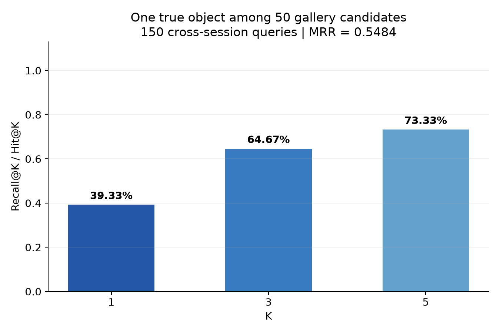
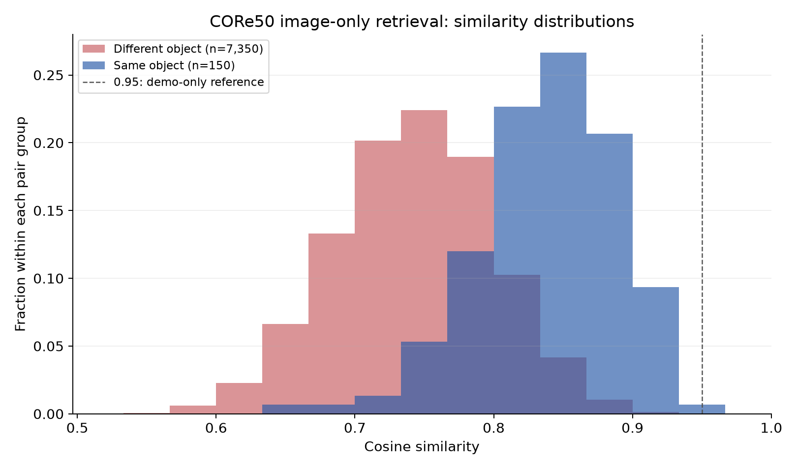

# FindIt — Real-image AI Visual Matching Evaluation

**Trạng thái: COMPLETE.** Benchmark local chạy mô hình CLIP thật của FindIt, không fine-tune, không đổi production và không truy cập database. Thời điểm đo (UTC): `2026-11-23T01:17:17.400Z`. Thời điểm được lưu từ đồng hồ môi trường chạy; ngày/seed của thí nghiệm theo yêu cầu là 23/11/2026 và `20261123`.

## Dataset and source

Nguồn gốc: [CORe50, University of Bologna](https://vlomonaco.github.io/core50/); phân phối: [nhuy165/core50-sessions](https://huggingface.co/datasets/nhuy165/core50-sessions), revision `b4aa74e696e8900fd3c4200a840debc1b008a628`. Giấy phép CC BY 4.0 theo trang chính thức và dataset card; nghiên cứu giữ thông tin tác giả, liên kết và chỉ rõ biến đổi. Không tải toàn bộ 5.86 GB. API `/filter` báo chỉ mục chưa sẵn sàng; dùng `/rows` để tải từng ảnh, xác minh label và session. Danh sách `paths.pkl` chính thức chỉ được đọc opcode chuỗi bằng `pickletools`, dùng số lượng frame để tính địa chỉ nhóm; không thực thi pickle.

Tập cuối có **50 vật thể, 200 ảnh RGB thật 128×128, 50 gallery và 150 query**, thuộc 10 danh mục. Một ảnh session 1/vật thể làm gallery (FOUND); ba ảnh session 3, 7, 10/vật thể làm query (LOST). Mỗi query so với toàn bộ **50 ứng viên**, không lọc category. LOST/FOUND chỉ là vai trò mô phỏng; đây không phải dữ liệu bài đăng mất đồ thật, cũng không phải protocol continual-learning chuẩn của CORe50.

Lấy mẫu deterministic: seed `20261123`; frame ordinal nội nhóm `40 + uint32(SHA256(seed:object:session)[0:8]) % 200`. Dùng số frame từng nhóm từ chỉ mục chính thức, cộng dồn theo session/object tăng dần, và kiểm tra nhãn nguồn trả về cho từng dòng. Source row index, revision, URL không chứa chữ ký hết hạn, object/category/session, vai trò, SHA-256 file và pixel có trong manifest. Ảnh khác session ngăn việc lấy hai frame video liên tiếp cho cùng vật thể.

**Ảnh được phục vụ ở dạng JPEG của Hugging Face Dataset Viewer**, không phải PNG gốc byte-for-byte. Đây vẫn là ảnh thật có nhãn nguồn; việc mã hóa lại có thể làm thay đổi chi tiết. Không tuyên bố checksum JPEG trùng PNG gốc hoặc đã kiểm chứng pixel với archive gốc. Nguồn mirror cung cấp label 0–49 tương ứng o1–o50 và session 1–11; độ chính xác provenance ngoài nhãn công bố phụ thuộc nguồn phân phối. Lượt tải subset hoàn tất nhận 932,089 byte (gồm phản hồi metadata); chỉ mục chính thức khoảng 5.28 MB và model q8 89.12 MB được tải riêng vào cache. Tổng vẫn thấp hơn 750 MB; model/cache/ảnh gốc không đưa vào Git.

## Model configuration and production equivalence

- Model: `Xenova/clip-vit-base-patch32`, CLIP ViT-B/32; revision `4c1807b705b1d015fb032789cc4d221b23025a6f`; dtype `q8`; 512 chiều.
- Model ONNX: `vision_model_quantized.onnx`, SHA-256 `583fd1110a514667812fee7d684952aaf82a99b959760c8d7dca7e0ab9839299`.
- Transformers.js 3.8.1; ONNX Runtime Node 1.21.0; sharp 0.35.5; Node v24.21.0.
- CPU, ONNX intra/inter-op threads = 1/1, đúng cấu hình encoder production.
- Gọi trực tiếp `createClipEncoder()` từ `server/ai-visual/clip-encoder.js`: sharp đọc/kiểm tra/rotate/đổi sRGB/bỏ alpha, resize trong 1024 không upscale; RawImage đi vào extractor production. Preprocessor model resize cạnh ngắn 224, center crop 224×224, rescale 1/255, normalize với mean [0.48145466, 0.4578275, 0.40821073] và std [0.26862954, 0.26130258, 0.27577711]; resample code 3 theo cấu hình pin.
- L2 normalize, ghi/đọc float32 bằng `encodeEmbedding`/`decodeEmbedding` production; cosine dùng `cosineSimilarity` production. Với một ảnh/vật thể, cosine này tương đương phép max-over-images của snapshot production. Sort giảm dần, tie-break object ID tăng dần, tương ứng candidate item ID trong thí nghiệm.
- Đối chiếu đủ 150 query bằng `rankOppositeObjects` production; sai khác điểm tối đa 0, thứ tự khớp. So với cosine tham chiếu có chia norm, sai khác tối đa 3.56e-08. Embedding norm [0.999999978, 1.000000022].

Hash các file production được lưu trong `verification.json`. Benchmark chỉ import các module thuần về model/math/config; không load dotenv, server startup, migrations, MySQL, Cloudinary, email hoặc notifications. Nhãn object/category/session không được truyền vào extractor. Chúng chỉ dùng định danh gallery, xác minh dữ liệu và tính ground truth.

## Evaluation methodology

Mỗi query có đúng một gallery relevant theo object ID. Gọi r(q) là hạng đúng và Q=150:

- Recall@K = Hit@K = (1/Q) Σ 1[r(q) ≤ K].
- MRR = (1/Q) Σ 1/r(q).
- Precision@K = (1/Q) Σ (1[r(q) ≤ K]/K). Vì chỉ một relevant, Precision@3 tối đa 1/3.
- Positive: cùng object ID; negative: khác object ID. Có 150 positive và 7,350 negative trên 7,500 cặp query/gallery. Các cặp dùng chung vật thể nên không độc lập thống kê.
- Không huấn luyện hoặc chọn threshold trên tập đánh giá. Không dùng category để giảm gallery. Một lần đo đầy đủ 200 ảnh sau 3 warmup; kiểm tra lặp lại inference và xác minh công thức bằng test.

## Quantitative results

| Metric | Kết quả |
|---|---:|
| Recall@1 / Hit@1 | 39.33% |
| Recall@3 / Hit@3 | 64.67% |
| Recall@5 / Hit@5 | 73.33% |
| MRR | 0.548444 |
| Precision@1 | 39.33% |
| Precision@3 | 21.56% |
| Precision@5 | 14.67% |

| Query session | Queries | Recall@1 | Recall@3 | Recall@5 | MRR |
|---|---:|---:|---:|---:|---:|
| 3 | 50 | 44.00% | 72.00% | 78.00% | 0.5992 |
| 7 | 50 | 40.00% | 66.00% | 72.00% | 0.5547 |
| 10 | 50 | 34.00% | 56.00% | 70.00% | 0.4914 |

| Cặp | n | Mean | p50 | p95 | Min | Max |
|---|---:|---:|---:|---:|---:|---:|
| Positive | 150 | 0.8378 | 0.8420 | 0.9133 | 0.6353 | 0.9586 |
| Negative | 7350 | 0.7424 | 0.7434 | 0.8346 | 0.5367 | 0.9236 |

Histogram dùng cùng bin [-1,1], chuẩn hóa riêng mỗi nhóm theo số cặp; `similarity_histogram.csv` lưu counts để kiểm chứng. Overlap: 7114 negative ≥ min positive; 145 positive ≤ max negative. Cosine không phải xác suất cùng vật thể.

## Existing threshold analysis

FindIt hiện **không có ngưỡng cosine xác nhận danh tính đã được kiểm định**: endpoint trả top 3. `notification-policy.js` mặc định chặn thông báo khi không có validated policy. `AI_VISUAL_NOTIFICATION_DEMO_MIN_COSINE=0.95` là ngưỡng demo dành cho fixture synthetic, không phải ngưỡng production ảnh thật. Điểm business matching khác cosine không được trộn vào thí nghiệm này.

Chỉ mô tả ngưỡng demo cố định 0.95 trên dữ liệu thật, không dùng để khuyến nghị triển khai: TP=1, FP=0, TN=7350, FN=149; precision=1, recall=0.006666666666666667, FPR=0. Với chấp nhận Top 1 khi cosine ≥0.95: 1/150 query được nhận, coverage=0.67%, precision=1. `null` nghĩa mẫu số bằng 0, không phải 0%.

Không tìm ngưỡng mới, không có calibration split và không tuyên bố kiểm thử threshold độc lập. Cần dữ liệu calibration riêng và evaluation mới nếu muốn lựa chọn ngưỡng.

## Performance

Máy đo: 13th Gen Intel(R) Core(TM) i7-13650HX, 20 logical CPUs, RAM 23.71 GiB; Windows 11 Home Single Language / win32 10.0.26200 x64. Chỉ CPU, không GPU. Node v24.21.0.

Khởi tạo model từ cache, download bị tắt: timer trong encoder 305.566 ms; wall bao gồm gọi tạo encoder 306.376 ms. Đây là **một phép đo startup**, không có p50/p95 startup. Tải model ban đầu lưu riêng trong `model_preparation.json` và không tính là inference. Sau 3 warmup, đo tuần tự 50 gallery +150 query, một lượt đầy đủ. p50/p95 dùng nearest-rank `sorted[ceil(p*n)-1]`.

| Giai đoạn | n | Mean ms | p50 ms | p95 ms |
|---|---:|---:|---:|---:|
| Extractor timer | 200 | 52.539 | 41.213 | 106.647 |
| Image embedding incl. local decode | 200 | 55.529 | 44.701 | 109.802 |
| Cosine + sort (50 vectors) | 150 | 0.065 | 0.052 | 0.096 |
| Warm query end-to-end | 150 | 61.330 | 48.808 | 110.669 |

Timer `inference_ms` của encoder bao gồm tiền xử lý bên trong extractor, ONNX và chuẩn hóa đầu ra; **không đo riêng kernel ONNX**. `embedding_ms` thêm đọc/giải mã ảnh local và chuyển float32. Warm query end-to-end là đo thực tế từ trước embed đến sau cosine/sort với 50 gallery vectors đã cache, không phải tổng hai percentile. Không gồm DB, Cloudinary, network, HTTP/UI hoặc initialization. RSS quan sát sau mỗi ảnh lớn nhất 454.45 MiB; peak process từ `resourceUsage().maxRSS` 454.46 MiB; không phải RAM riêng của model và sampling theo ảnh có thể bỏ lỡ đỉnh. Đây là latency local tại thời điểm đo; không suy ra tốc độ production Railway.

## Error analysis

Xem [error_analysis.md](error_analysis.md), [selected_examples.json](selected_examples.json), [retrieval_examples.png](retrieval_examples.png). Có 59 query đúng Top 1, 38 query đúng hạng 2–3, 53 query ngoài Top 3. 55/91 lỗi Top 1 là nhầm vật cùng category. Chi tiết góc chụp/ánh sáng/background chỉ là phân tích định tính của hình, không gán nhãn ground truth mới hoặc khẳng định quan hệ nhân quả.

## Verification and reproducibility

`evaluation.test.mjs` kiểm tra công thức Recall/Precision/MRR, threshold >=, denominator rỗng, object/category/session, split, checksum/duplicate và phép cosine production bằng ví dụ giải tích. Các vector giải tích chỉ là unit fixtures, không được dùng trong nghiên cứu. `evaluate.mjs` giải mã toàn bộ ảnh, xác minh RGB/kích thước/checksum file và pixel; kiểm tra unique source rows và session tách biệt; norm 512 chiều; đối chiếu cosine độc lập, production rank và inference lặp lại. `verify.mjs` xác minh lại CSV/JSON/vector/bin/chart từ dữ liệu lưu.

Hướng dẫn đầy đủ và lệnh chạy ở [../README.md](../README.md). Pipeline production không sửa; source hash trước/sau có thể đối chiếu. Manifest/CSV/JSON có thể commit; `data/` và `cache/` được ignore. Không push, merge, deploy hoặc sửa báo cáo Word.

## Limitations and academic use

Đủ bằng chứng cho **một thí nghiệm truy xuất ảnh thật có nhãn, tái lập được, trong phạm vi CORe50 subset**: 50 gallery, 150 query, bốn session cố định. Không đủ để khẳng định chất lượng hệ thống mất đồ thực tế hoặc tự động xác nhận danh tính. Gallery chỉ một ảnh/vật, không có query “không có đáp án”, không có vật ngoài 50 ID, không khảo sát quy mô lớn, không test đa ảnh/item hoặc hoạt động DB/UI. Model không huấn luyện trên subset nhưng không thể xác nhận CORe50 hoàn toàn vắng mặt trong dữ liệu pretrain của CLIP. Mirror/Viewer JPEG có thể khác PNG gốc. Một gallery session, một seed và chỉ 3 query/vật làm kết quả nhạy với cách chọn ảnh; các query và cặp điểm có tương quan, không được diễn giải như 7.500 mẫu độc lập. Chưa có nhiều seed/session gallery, confidence interval theo cụm vật thể, kiểm chứng với dữ liệu bài đăng thật, hoặc đánh giá open-set. Các quan sát ảnh không chứng minh nguyên nhân lỗi. Không dùng kết quả này để chọn threshold triển khai.

## References

1. Lomonaco, V. & Maltoni, D. (2017). [CORe50: a New Dataset and Benchmark for Continual Object Recognition](https://proceedings.mlr.press/v78/lomonaco17a.html). CoRL, PMLR 78:17–26.
2. [CORe50 official dataset and license](https://vlomonaco.github.io/core50/), [official paths index](https://vlomonaco.github.io/core50/data/paths.pkl).
3. [nhuy165/core50-sessions dataset card](https://huggingface.co/datasets/nhuy165/core50-sessions), revision `b4aa74e696e8900fd3c4200a840debc1b008a628`; [Hugging Face Dataset Viewer row API](https://huggingface.co/docs/dataset-viewer/rows).
4. [Pinned Xenova CLIP model](https://huggingface.co/Xenova/clip-vit-base-patch32/tree/4c1807b705b1d015fb032789cc4d221b23025a6f); [CLIP paper](https://proceedings.mlr.press/v139/radford21a.html).
5. Repository: `server/ai-visual/{config,clip-encoder,embeddings,notification-policy}.js`, `server/ai-visual/snapshot-service.js`, `server/repositories/visual-suggestions.repository.js`, `server/tests/ai-real-e2e.js`, `docs/CI-AI-E2E-20261109.md`, `docs/AI-AUTO-MATCHING-PRODUCTION.md`. Existing E2E uses synthetic drawings with real CLIP and validates integration; its scores do not establish real-object accuracy.

## Full second-pass reproduction

Hai process độc lập, mỗi process suy luận lại đủ 200 ảnh từ cùng checksum/model. 7500 cặp cosine được đối chiếu: sai khác tối đa 0; vector sai khác tối đa 0; thứ hạng và metric khớp hoàn toàn. Không dùng lại vector của lượt đầu cho inference lượt hai. Số latency trong báo cáo là **lượt thứ hai đã chỉ định trước**, không chọn lượt nhanh hơn; mỗi bảng percentile dùng 200 ảnh/150 query của lượt đó. Chi tiết latency cả hai lượt trong `reproducibility.json`.
